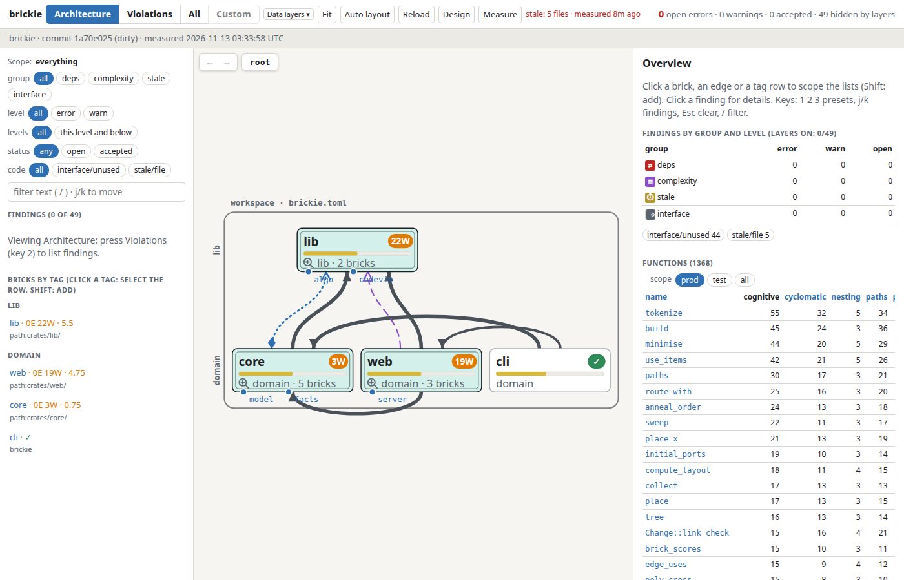

# brickie

[](https://github.com/idnwit/brickie/actions/workflows/ci.yml)
[](https://github.com/idnwit/brickie/actions/workflows/dev-release.yml)
[](https://github.com/idnwit/brickie/releases/latest)

Check a Rust workspace against architecture rules you write yourself, and review what coding agents changed.

[](docs/webui.md)

## What it does

1. **Measure**: finds the dependencies between modules and the complexity of every function.
2. **Check**: compares the results with the rules in `brickie.toml` and fails CI on violations.
3. **View**: a local web page shows bricks, dependencies and findings next to the source.

You group crates and modules into *bricks* and say which bricks may depend on which. brickie has no
built-in architecture: the rules are yours. Coding agents read `brickie llms.txt` to learn the workflow.

## Install

```sh
curl -fsSL https://raw.githubusercontent.com/idnwit/brickie/main/install.sh | sh
```

Linux x86_64 and macOS. `brickie measure` also needs `rust-analyzer` on `PATH`. Other options and
building from source: [docs/usage.md](docs/usage.md).

## Quick start

Create `brickie.toml` in the workspace root:

```toml
[[brick]]
name = "engine"
members = ["acme-engine"]    # a package, module prefix or path

[[brick]]
name = "app"
members = ["acme-app"]

[deps]
default = "allow"            # edges matching no rule

[[deps.rule]]
from = "engine"
to = "app"
action = "deny"
reason = "the engine must not depend on the app"

[[complexity]]
bricks = "*"
cognitive = 15               # a function above this fails
level = "error"
```

Then:

```sh
brickie measure   # slow, once per code change: runs rust-analyzer
brickie check     # fast: exits 1 on errors
brickie serve     # viewer on http://127.0.0.1:7881
```

A dependency rule defaults to `scope = "prod"`; edges from test code need `scope = "test"` or `"all"`.
`check` verifies structure, not runtime behaviour: keep the project's own tests.

## Docs

| Topic | Where |
| --- | --- |
| Install, commands, CI, building the viewer | [docs/usage.md](docs/usage.md) |
| Full config reference and diagnostic codes | [docs/llms.txt](docs/llms.txt), [example](docs/examples/brickie.toml) |
| What each metric means, with examples | [docs/metrics](docs/metrics/README.md) |
| The web viewer | [docs/webui.md](docs/webui.md) |
| Design | [docs/design.md](docs/design.md) |
| Contributing and releases | [CONTRIBUTING.md](CONTRIBUTING.md) |

## License

[MIT](LICENSE)
