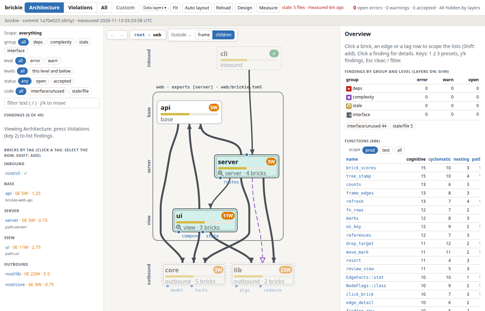
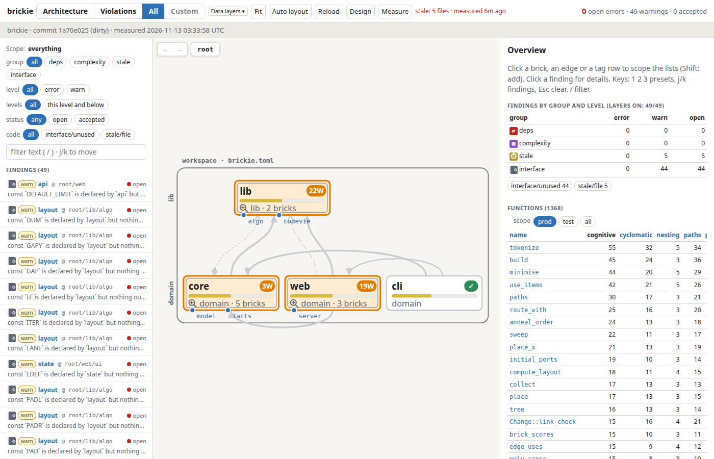
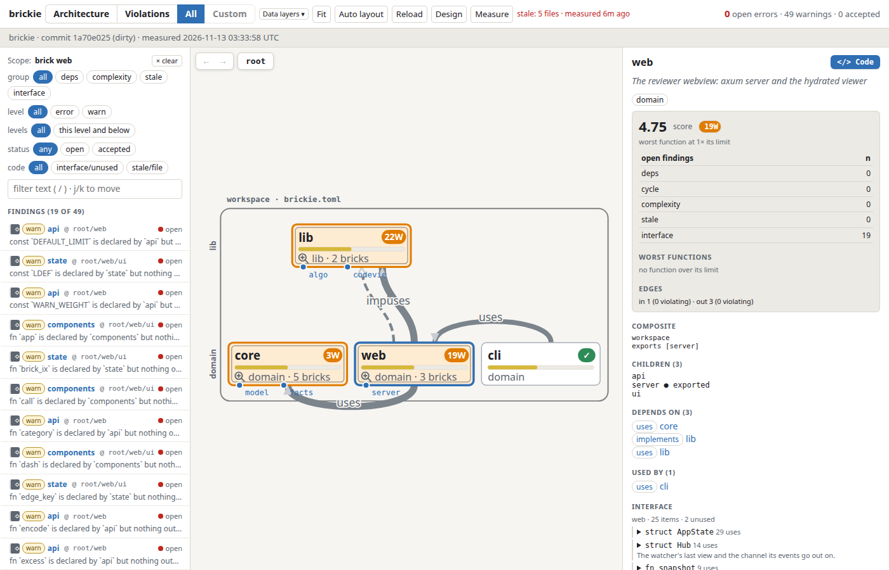

# Reviewer webview

`brickie serve` starts a local page that shows what `brickie measure` found: bricks, the
dependency edges between them, findings and function complexity. It is meant for reviewing what a
coding agent changed. Design notes: [design.md](design.md).

```sh
brickie measure          # write the cache
brickie serve            # http://127.0.0.1:7881/ (--port, --bind)
```

The page reads the cache and `brickie.toml`; it shows the same findings as `brickie check`. The
Measure button re-runs measure inside the server, and the page updates when the cache changes.
The screenshots below show brickie measuring its own workspace.

## Overview


- Centre: the bricks of the current level, grouped by tag, with their dependency edges. The bar
  and badge on a brick show its score: open findings plus how far its worst functions exceed
  their limits.
- Left: filters (group, level, status, code, free text) and the bricks listed by tag.
- Right: with nothing selected, findings by group and the functions table (cognitive,
  cyclomatic, nesting, paths, ...). Click a column to sort.
- Header: presets Architecture, Violations, All and Custom (keys `1`, `2`, `3`), the Data layers
  menu, Fit, Auto layout, Reload, Design and Measure.

## Nested bricks



A brick with a magnifier icon holds child bricks. Click the icon to open that level. The
breadcrumb at the top (`root > web`) goes back up, and the arrow buttons step through history.
Neighbours outside the brick appear above (inbound) and below (outbound) in faded colour. The
Outside toggle ends their edges at the frame or at the child bricks. Each level is checked by
its own `brickie.toml`.

## Findings



The All preset lists every finding (here 49 `interface/unused` and `stale/file` warnings). Each
row shows severity, brick, level and status; click one for details and the source location.
The Violations preset (key `2`) shows only error-level findings, and a sub-filter picks one group:
deps, complexity, stale or interface. This workspace has no open errors, so that view is empty.

## Brick detail



Click a brick, an edge or a tag row to scope every list to it (Shift adds to the selection; Esc
clears). The right panel then shows the score, open findings by group, the worst functions, the
edges in and out, what the brick depends on and who uses it, and its declared interface with the
number of uses per item. The Code button opens the brick in the embedded code viewer; any
`file:line` link opens it at that place.

## Unused links

An allow rule between two bricks that no measured edge backs draws as a link in both modes, one
line per brick pair (the tooltip lists every rule with its reason and what it waits for). Dash is the edge kind (`implements`, `reexports`).

| Look | Meaning |
| --- | --- |
| warning-colour line with `!` | unused: no measured edge matches the rule (`deps/unused`) |
| warning-colour `?` | the rule has no reason |
| `A` | an agent added the rule |

Hover or select a link to see its reason (cut to 40 characters, full text in the tooltip); on
touch a tap selects it. Reasons never show on all links at once.

## Design mode

`Design` (or `E`) switches to Design mode (`edit=1`): the canvas edits the live design. Every
edit is written to the `brickie.toml` files at once as a new version (`v12`); there is nothing
to review or publish. The bar under the header shows the version and who made it (agent violet,
you, hand edit), task chips (planned bricks, rules without a reason) and Undo / Redo.

- Toolbar (one row over the canvas): Select / Hand, brick tiles (Crate, Module, Group: drag one
  onto the canvas, a brick, a tag lane or the "+ new tag lane" zone), link types (arm one, then
  drag a port onto a sibling or a lane), the scope of new rules, Delete and `?` (shortcuts).
- Drag a brick onto a brick to nest it, onto a lane to retag it, onto the "+ new tag lane" zone
  under the level to give it a new tag, onto the frame edge or a breadcrumb to move it up.
- The panel: Inspector (the selection), Rules (rules and complexity limits of the level), Level,
  Files and History (every version with its author, diff lines and an Undo).
- Undo (`Ctrl+Z`) reverts your latest edit as a new version; Redo (`Ctrl+Shift+Z`) reverts the
  undo.
- When a coding agent (`brickie design ...`) or a hand edit changes the design, the page updates
  in place and a toast names the change with an Undo (`agent v16: <note>` when the version has
  a note). An edit of yours based on an older version is re-sent on the new one only when no
  version in between touched the same brick, rule or limit; otherwise a toast says
  `Not applied: agent v16 changed brick web`.
- The copy icon next to the name of a selected brick or rule (tooltip "Copy ref for the agent")
  copies its CLI name (`web/api`, `rule web -> store (prod)`) to paste into the agent's chat.
- Bricks keep where you drop them (`.brickie/layout.json`, not part of the design). Auto layout
  forgets the positions of the level on screen and lays it out again.

## URL state

The view lives in the URL query, so back/forward and shared links show the same view. Some
parameters: `lv=root/web` (level), `brick=web`, `p=viol|all` (preset), `vs=deps|cx|stale|iface`,
`fn_sort=cyclomatic`, `edit=1`.

## Regenerating the screenshots

Run `scripts/build-ui.sh`, `brickie measure`, then `brickie serve` and capture the pages above in
a 1400x900 window.
