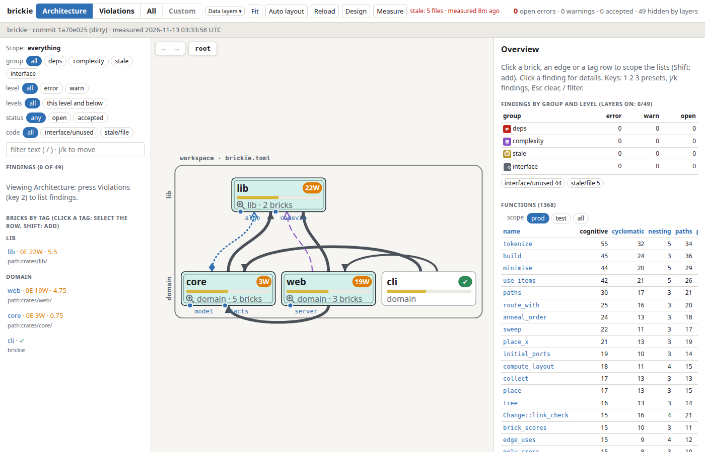
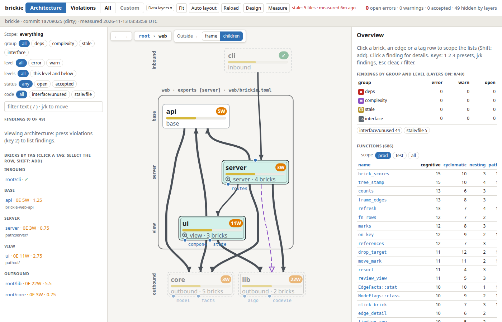
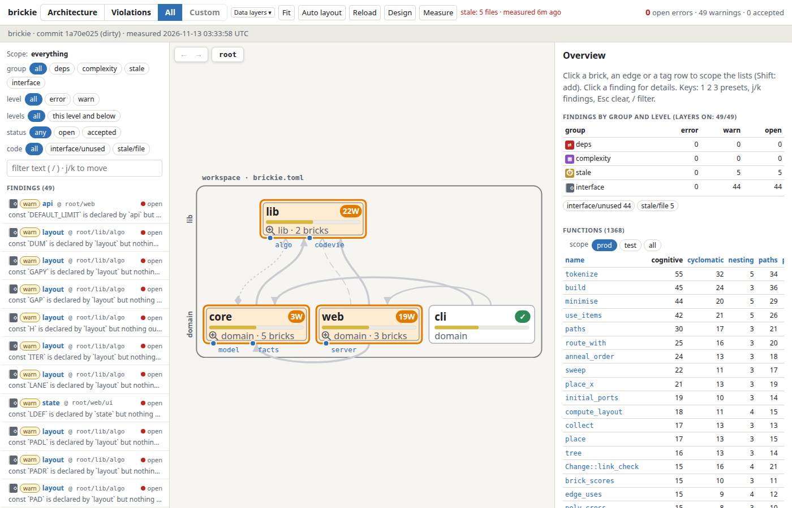
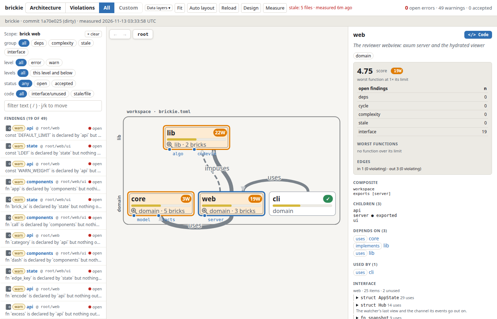

# Reviewer webview

`brickie serve` starts a local page that shows what `brickie measure` found: bricks, the
dependency edges between them, findings and function complexity. It is meant for reviewing what a
coding agent changed. Principles: [design/ux.md](design/ux.md) (cited as P1..P19). Design notes:
[design.md](design.md). Code: `crates/web/ui`, `crates/web/api`.

```sh
brickie measure          # write the cache
brickie serve            # http://127.0.0.1:7881/ (--port, --bind)
```

The page reads the cache and `brickie.toml`; it shows the same findings as `brickie check`. The
Measure button re-runs measure inside the server, and the page updates when the cache changes.
The screenshots show brickie measuring its own workspace.

## Overview

Serves: P3, P13, P15, P16.



- Four regions. Centre: the bricks of the current level, grouped by tag, with their edges.
  Left: filters (group, levels, code, free text) and the bricks listed by tag. Right:
  with nothing selected, findings by group and the functions table (click a column to sort);
  with a selection, its score, findings, worst functions, edges, interface and a Code button.
  Header: presets, the Data layers menu, Fit, Auto layout, Reload, Design and Measure.
- A brick shows its name, tag, a heat bar and a badge with its finding count; the tooltip
  reads `score S (N finding(s), complexity excess X)`. The score is `findings
  + sum over functions of max(0, worst ratio - 1)`. It is computed
  only in `crates/web/api/src/model/score.rs`.
- The heat bar fills `worst ratio / 2` and has four levels: below 0.8, below 1, up to 1.5, above
  1.5 of the limit.
- Presets: Architecture (default; edges and `deps` findings), Violations (only edges and bricks
  with findings, with a sub-filter: all, deps, complexity, stale, interface), All, and Custom (entered only by
  changing a data layer).

## Nested bricks

Serves: P14.



A composite brick has a double inner outline and a magnifier icon; click the icon or double-click
the brick to open its level. The breadcrumb (`root > web`) goes back up, with back and forward
buttons. Neighbours outside the level are faded with a dashed outline, inbound above and outbound
below. The Outside toggle (`bnd`) ends their edges at the child they reach (`children`) or at the
frame wall (`frame`). A private edge stops at the frame wall (no cross glyph) and its tooltip
says "private: stops at the wall". Each level is checked by its own `brickie.toml`. Holding a
dragged brick on a group opens it after a delay, shown as a charging outline.

## Findings

Serves: P3, P17.



The All preset lists every finding (here 49 `interface/unused` and `stale/file` findings). Each
row shows the group, bricks and level; click one for details and the source location.
The Violations preset keeps only edges and bricks that carry a finding in the chosen scope.

## Brick detail

Serves: P3, P17.



Click a brick or an edge to scope the lists to it (one selection at a time; clicking it again
or Esc clears). A link scopes the findings list to its own findings and hides the Functions
table. The right panel shows the score, open findings by group, the worst functions, the
edges in and out, what the brick depends on and who uses it, and its declared interface with
uses per item. Every `file:line` link and the Code button open the source popup: an iframe of
`/code/` with "open in a tab", full-screen and close buttons; `Esc` closes it first. The code
viewer is read-only and does not depend on bricks, rules or the cache.

## Edges and links

Serves: P12, P13.

A measured edge shows an abbreviation of its kind at the middle and, at the same place, a cross
when it is debt. Width follows its count; `reexports` has a tail mark.

A valid link that no measured edge backs draws as a planned link, one line per brick pair (the
tooltip lists every link with its reason). In Design mode the canvas also draws the links that
code already uses, in the colour of their kind; a link no rule allows (`design/link-denied`) is red with
the reason in its tooltip, and a link on a cycle of links is marked. Rules are listed in the Rules
tab, not drawn. Dash is the edge kind.

| Look | Meaning |
| --- | --- |
| warning-colour line with `!` | planned: the link has no measured edge yet |
| red line | Design mode, denied: no rule allows the link (blocks Publish) |
| cycle mark on a link | the link is on a cycle of links (information only) |
| `A` | an agent added the rule or link |
| short-dash outline, warning colour | unassigned brick |
| book icon before the name, dashed box | independent lib (tooltip says what it means) |

Marks sit at the route point nearest the middle that is clear of boxes and other marks. A reason
shows (cut to 40 characters, full text in the tooltip) on hover or selection only; on touch a tap
selects.

## Design mode

Serves: P1, P2, P4, P5, P6, P7, P8, P9, P10.

The canvas always shows the working design (the draft when one exists, else the published
design) with the measured code ([working design](design/editor.md#working-design)). `Design`
(or `E`, `edit=1`) turns editing on. Every edit is a new version (`v12`) of the draft;
publishing makes it the published design once the code matches it. A design with structure
errors (such as `config/missing`) still renders, with the errors listed as findings. Without a
measured cache Design mode falls back to the design files alone and the bar shows a `design only:
no measurements` chip (its tooltip says why); view mode needs the cache.

- A bar under the header shows `published v<N>`; with a draft, `draft v<N> . from v<M>`, its
  `behind: rebase` when the published head moved, and Publish (runs the gate; disabled when
  behind), Rebase (enabled when behind) and Discard (asks first). A blocked publish lists its
  blocking items in the bar's message. Then `v<N> . <author>` (opens History; agent violet, you,
  hand edit), the chip of denied links (opens the Inspector on the first), an error chip when the
  design does not load, and Undo and Redo with tooltips naming what they would do.
- Toolbar, one row: Select and Hand; brick tiles Crate, Module, Group; link types; the scope of
  new links; Delete and `?`. It never wraps: below 1280 px labels give way to glyphs with
  tooltips, and the rest scrolls sideways. It is collapsible.
- Drag a brick tile onto the canvas, a brick (nest it), a tag lane (retag), the "+ new tag lane"
  zone (new tag), or the frame edge or a breadcrumb (move up). A drop target is outlined with a
  label of what the drop does; a refused one is marked in the error colour with the reason.
- Arm a link type (`L` or a toolbar button), then drag a port from a brick onto a sibling or a
  lane; there is one port per type and no form after the drop, and the drop creates a link
  (a rule is added in the Rules tab, never by dragging). Drag the arrowhead of a selected link to
  change its target.
- Panel tabs: Inspector, Rules, Level, Files, History (every version with author, diff lines and
  an Undo); all but History are scoped to the level on screen.
- Undo reverts your latest edit as a new version; Redo reverts the undo.
- Moving a brick writes only a layout hint (`.brickie/layout.json`), not a version. Auto layout
  clears the hints of the level on screen, lays it out again and fits.
- The copy icon "Copy ref for the agent" in the inspector copies the CLI name (`web/api`,
  `link web -> store`).
- Click a link to select it (again: the next link of the pair) and edit or delete it in the
  Inspector.
- Delete asks for confirmation for a brick and removes a selected rule or link at once.

## Live updates and toasts

Serves: P7, P8, P11.

The page patches a new version in place through `/api/events`, waits while a drag, a name being
typed or a request is in progress, and polls every 3 s when `EventSource` is missing. Changes of
the cache or the config raise a "refresh" pill instead of reloading the view. A toast appears at
the bottom left of the canvas: a write by another writer shows `agent v16: <note>` (or
`agent changed: <first diff line>`) with an Undo for 6 s; others last 2.5 s. An edit of yours based
on an older version is re-sent on the new one only when no version in between touched the same
element; otherwise `Not applied: agent v16 changed brick web`.

## Keys

Serves: P4, P18.

| Key | Effect | Where |
| --- | --- | --- |
| `1` `2` `3` | preset Architecture, Violations, All | view mode |
| `1` `2` `3` | scope of new links: prod, test, all | Design mode |
| `E` | toggle Design mode | always |
| `Esc` | one step back: drag, armed tool, form, popup, finding, selection, then zoom out | always |
| `Backspace` | out to the parent level | always |
| `/` | focus the free-text filter | view mode |
| `j` `k` | next, previous finding | view mode |
| `Alt+Left`, `Alt+Right` | back, forward through levels | always |
| `V` `H` | select tool, hand tool | Design mode |
| `B`, `Tab` | brick tool, next kind (crate, module, group) | Design mode |
| `L` | link tool | Design mode |
| `F2` | rename the selected brick | Design mode |
| `Del` | delete the selection | Design mode |
| `Ctrl+X`, `Ctrl+V` | cut a brick, paste it on another level | Design mode |
| `Ctrl+Z`; `Ctrl+Shift+Z` or `Ctrl+Y` | Undo; Redo | Design mode |
| `+` `-` `0` | zoom in, out, fit | Design mode |
| `?` | shortcut sheet (closed by `Esc` or `?`) | Design mode |

Keys never fire while a text field has focus, and the Design key handler takes a key before the
page handler. Every brick is focusable and shows an outline in the selection colour.

## URL state

Serves: P11, P15, P17.

The query holds the view with defaults omitted and keys in a fixed order, so equal views have
equal URLs. Links that change the view have a real `href`; a plain click updates the view without
a page load. Changing the level clears the brick, edge and finding selections. Without
JavaScript the server renders the full page read-only from the same components and query.

| Parameter | Meaning | Default |
| --- | --- | --- |
| `lv` | level path, such as `root/web` | `root` |
| `brick`, `edge`, `item` | selected brick, edge `from>to>kind`, finding | none |
| `p` | preset: `arch`, `viol`, `all`, `custom` | `arch` |
| `lay` | layer differences from the preset, `-cx,+tests` | none |
| `vs` | Violations scope: `deps`, `cx`, `stale`, `iface` | `all` |
| `grp`, `code` | findings group, code or family | none |
| `below` | `1`: findings of this level and below only | off |
| `bnd` | outside edges: `children` or `frame` | `children` |
| `fn_sort`, `fn_dir`, `fn_scope`, `fn_limit` | function table sort, direction, scope, rows | cognitive, desc, prod, 50 |
| `edit` | `1`: Design mode | off |

## Colour tokens

Serves: P12, P13, P18.

Colours are CSS variables in `crates/web/ui/styles/`, redefined for dark under
`prefers-color-scheme: dark` unless `data-theme=light`. Classes change colour, dash and stroke
width, never size or position.

| Token | Purpose | Light | Dark |
| --- | --- | --- | --- |
| `--bg`, `--panel`, `--ink` | page, panels, text | `#f6f5f2` `#fff` `#1d2126` | `#15181c` `#1d2126` `#e6e8ea` |
| `--muted`, `--line` | secondary text, borders | `#5d6670` `#d9d6cf` | `#9aa3ab` `#343a41` |
| `--band`, `--hl` | hover and header bands, highlighted row | `#eceae4` `#eef3fb` | `#262b31` `#223044` |
| `--sel` | selection, focus | `#2f6fb3` | `#6aa7ff` |
| `--c-ok` | healthy edge, brick | `#7d858d` | `#8d959d` |
| `--c-debt` (`--err`) | violation, error | `#c0261f` | `#ff6a5f` |
| `--bd-amber` (`--warn`) | warning, planned link | `#a67c00` | `#f1d98a` |
| `--bd-green`, `--ok` | within limit, allow | `#2e8b57` | `#5fc88a` |
| `--c-acc` | stale-findings icon | `#b8962e` | `#d9b648` |
| `--agent` | agent author and mark | `#7e4bb0` | `#b98af0` |
| `--planned` | planned brick | `#7d858d` | `#9aa3ab` |
| `--h0` .. `--h3` | heat levels | `#5fb37f` `#d6b83a` `#e8892a` `#c0261f` | `#4aa56e` `#c9ab3a` `#e8892a` `#ff6a5f` |
| `--k-uses`, `--k-implements`, `--k-extends`, `--k-composes`, `--k-reexports` | edge kinds | `#4a5058` `#8a4fc4` `#2e8b57` `#2f6fb3` `#2f6fb3` | `#aab2ba` `#b98af0` `#5fc88a` `#6aa7ff` `#6aa7ff` |
| `--l-uses`, `--l-implements`, `--l-reexports`, `--l-deny` | link types in Design mode | `#2f7dd1` `#2e9e6b` `#d18a2f` `#d23c3c` | same as light |
| `--warn-bg`, `--warn-ink` | warning pill | `#fff4d6` `#6b4e00` | `#3a3014` `#f1d98a` |

## Open items

- Two ambers: `--warn` (`var(--bd-amber)`, defined across `theme.css` and `viewer.css`) and
  `--b-warn` (`#e07b00` light, `#ffa030` dark) on bricks. Pick one token.
- WCAG 2.1 AA contrast (P18) is not measured; there is no automated check.
- Keyboard reach (P18): bricks have `tabindex`, but toolbar tiles drag on `mousedown` and edge
  marks have no `tabindex`.
- Toasts have no `aria-live` region.
- Reduced motion covers only the drop-target and zoom animations; other transitions are unchecked.
- Not browser-tested: clipboard copy ref, the toolbar at narrow widths, drag gestures, and the
  loopback, `Host` and `Origin` guard of writing endpoints (P19).

## Regenerating the screenshots

Run `cargo build --release`, `brickie measure`, then `brickie serve` and capture the pages above in
a 1400x900 window.
