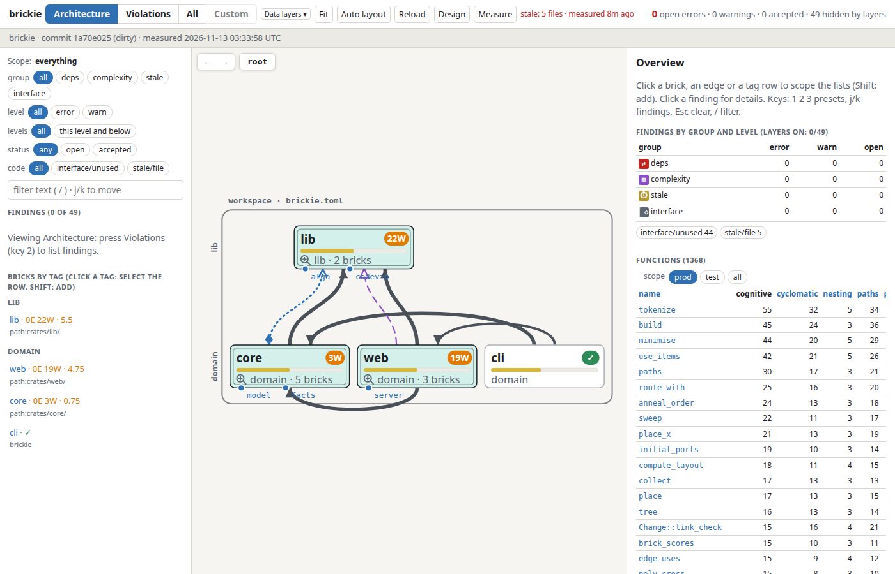
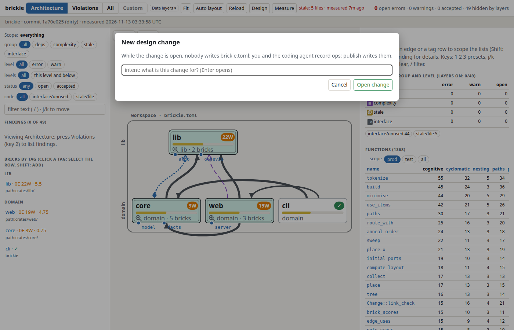

# Reviewer webview

`brickie serve` starts a local page that shows what `brickie measure` found: bricks, the
dependency edges between them, findings and function complexity. It is meant for reviewing what a
coding agent changed. Design notes: [design.md](design.md).

```sh
brickie measure          # write the cache
brickie serve            # http://127.0.0.1:7881/ (--port, --bind)
```

The page reads the cache and `brickie.toml`; it shows the same findings as `brickie check`. The
Measure button re-runs measure inside the server, and the page updates when the cache changes.
The screenshots below show brickie measuring its own workspace.

## Overview



- Centre: the bricks of the current level, grouped by tag, with their dependency edges. The bar
  and badge on a brick show its score: open findings plus how far its worst functions exceed
  their limits.
- Left: filters (group, level, status, code, free text) and the bricks listed by tag.
- Right: with nothing selected, findings by group and the functions table (cognitive,
  cyclomatic, nesting, paths, ...). Click a column to sort.
- Header: presets Architecture, Violations, All and Custom (keys `1`, `2`, `3`), the Data layers
  menu, Fit, Auto layout, Reload, Design and Measure.

## Nested bricks


A brick with a magnifier icon holds child bricks. Click the icon to open that level. The
breadcrumb at the top (`root > web`) goes back up, and the arrow buttons step through history.
Neighbours outside the brick appear above (inbound) and below (outbound) in faded colour. The
Outside toggle ends their edges at the frame or at the child bricks. Each level is checked by
its own `brickie.toml`.

## Findings


The All preset lists every finding (here 49 `interface/unused` and `stale/file` warnings). Each
row shows severity, brick, level and status; click one for details and the source location.
The Violations preset (key `2`) shows only error-level findings, and a sub-filter picks one group:
deps, complexity, stale or interface. This workspace has no open errors, so that view is empty.

## Brick detail


Click a brick, an edge or a tag row to scope every list to it (Shift adds to the selection; Esc
clears). The right panel then shows the score, open findings by group, the worst functions, the
edges in and out, what the brick depends on and who uses it, and its declared interface with the
number of uses per item. The Code button opens the brick in the embedded code viewer; any
`file:line` link opens it at that place.

## Design mode



Design (key `E`) asks for an intent and opens a change. While a change is open, nobody writes
`brickie.toml`: you and the coding agent record operations on the canvas, review them against
the rules, and Publish writes the file. Details: [design.md](design.md).

## URL state

The view lives in the URL query, so back/forward and shared links show the same view. Some
parameters: `lv=root/web` (level), `brick=web`, `p=viol|all` (preset), `vs=deps|cx|stale|iface`,
`fn_sort=cyclomatic`, `change=1`.

## Regenerating the screenshots

Run `scripts/build-ui.sh`, `brickie measure`, then `brickie serve` and capture the pages above in
a 1400x900 window.
